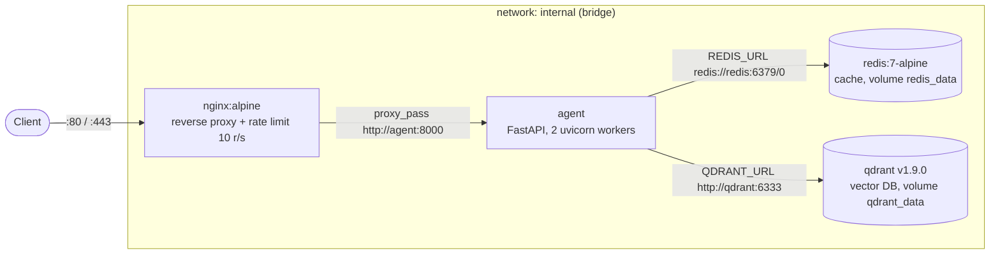

# Day 14 Lab — Mission Answers

> Các chỗ đánh dấu **⏳** là output phải lấy từ lệnh chạy thật trên máy (không tự điền số).
> Lệnh để lấy toàn bộ output Part 1, 2, 4, 5: `bash scripts/collect_evidence.sh` → file `evidence/part1-5.log`.

---

## Part 1: Localhost vs Production

### Exercise 1.1: Anti-patterns trong `01-localhost-vs-production/develop/app.py`

| # | Dòng | Anti-pattern | Hậu quả |
|---|------|--------------|---------|
| 1 | 17–18 | Hard-code secret: `OPENAI_API_KEY = "sk-hardcoded-..."`, `DATABASE_URL` chứa mật khẩu `password123` | Push lên GitHub là lộ key ngay (bot quét key chạy liên tục). Muốn đổi key phải sửa code và deploy lại |
| 2 | 34 | `print(f"[DEBUG] Using key: {OPENAI_API_KEY}")` | Secret bị ghi ra log, ai đọc được log (log aggregator, người trực ca) cũng thấy key |
| 3 | 33, 38 | Dùng `print()` thay cho logging, in nguyên câu hỏi và câu trả lời | Không có level, thời gian, không parse/lọc được; log cả nội dung người dùng (dữ liệu cá nhân) |
| 4 | 21–22 | `DEBUG = True`, `MAX_TOKENS = 500` cố định trong code | Không đổi được cấu hình theo môi trường (dev/staging/prod) mà không sửa code — vi phạm 12-Factor "Config" |
| 5 | 42–43 | Không có `/health` (và `/ready`) | Agent treo hoặc crash thì platform không biết để restart, load balancer không biết để ngừng gửi traffic |
| 6 | 51 | `host="localhost"` | Trong container chỉ nghe trên loopback → từ ngoài container không gọi được |
| 7 | 52 | `port=8000` cố định | Railway/Render cấp cổng qua biến `PORT`; nghe sai cổng thì platform không route được traffic vào app |
| 8 | 53 | `reload=True` luôn bật | File watcher của chế độ dev chạy cả trên production: tốn CPU, có thể tự restart giữa chừng |
| 9 | cả file | Không xử lý SIGTERM / không có lifespan | Khi platform tắt hoặc redeploy, request đang chạy bị cắt ngang |
| 10 | 30–31 | `/ask` không có xác thực, `question` nhận qua query string không giới hạn độ dài | Ai biết URL cũng gọi được (tốn tiền LLM); câu hỏi nằm trên URL nên lộ trong access log |

### Exercise 1.2: Chạy bản develop

```bash
cd 01-localhost-vs-production/develop
pip install -r requirements.txt
python app.py
curl -X POST "http://localhost:8000/ask?question=Hello"
```

⏳ Output (từ `evidence/part1-5.log`, mục `PART 1.2`):

```text
(chưa có)
```

**Quan sát:** app chạy và trả lời được, nhưng mỗi request terminal đều in ra API key (dòng 34). App chỉ nghe ở `localhost:8000` và không có endpoint `/health`, nên chưa sẵn sàng cho production.

### Exercise 1.3: So sánh develop và production

| Feature | Develop | Production | Tại sao quan trọng? |
|---------|---------|------------|---------------------|
| Config | Hard-code trong code (`DEBUG`, `MAX_TOKENS`, key) | `config.py` đọc env (`os.getenv`) + `.env.example`; `validate()` dừng app nếu thiếu `AGENT_API_KEY` khi `ENVIRONMENT=production` | Cùng một image chạy được ở mọi môi trường; đổi cấu hình không cần build lại; lỗi cấu hình lộ ra ngay lúc khởi động (fail fast) |
| Secrets | Ghi thẳng trong code và in ra log | Đọc từ env, không bao giờ log secret (chỉ log độ dài câu hỏi/câu trả lời) | Code public lên GitHub không lộ key; đổi key (rotate) chỉ cần đổi biến môi trường |
| Host / Port | `localhost:8000` cố định | `HOST=0.0.0.0`, `PORT` từ env | Container cần nghe trên `0.0.0.0`; platform quyết định cổng qua `PORT` |
| Health check | Không có | `GET /health` (liveness: uptime, version) và `GET /ready` (readiness: 503 khi chưa sẵn sàng hoặc đang tắt) | Platform tự restart instance chết; load balancer chỉ gửi traffic tới instance đã sẵn sàng |
| Logging | `print()`, có cả secret | Log dạng JSON qua `logging`, không chứa secret | Log aggregator (Loki, Datadog…) parse, lọc, cảnh báo được; không lộ dữ liệu nhạy cảm |
| Shutdown | Tắt đột ngột | `lifespan`: đặt `is_ready = False`, dọn dẹp, cho request đang chạy hoàn thành; có handler SIGTERM | Deploy hoặc scale down không làm hỏng request của người dùng |
| Reload / Debug | `reload=True` luôn bật | Chỉ reload khi `DEBUG=true` | Production không chạy file watcher |
| Input | Query string, không kiểm tra | JSON body, thiếu `question` → 422 | Báo lỗi rõ ràng cho client, không đưa dữ liệu lên URL |
| CORS | Không cấu hình | `CORSMiddleware` với `ALLOWED_ORIGINS` từ env | Giới hạn website nào được gọi API từ trình duyệt |

**Hai điểm bản production vẫn chưa ổn (rút kinh nghiệm cho Part 6):**

1. Log "JSON" được tạo bằng format string `'{"time":"%(asctime)s",...,"msg":"%(message)s"}'` trong khi message lại là `json.dumps(...)`. Dấu `"` trong message không được escape nên dòng log **không còn là JSON hợp lệ**. Part 6 dùng `JsonFormatter` tự viết, gọi `json.dumps` cho cả dòng.
2. `signal.signal(signal.SIGTERM, handle_sigterm)` chỉ log mà không gọi lại handler cũ. Nếu chạy bằng `uvicorn app:app`, module được import sau khi uvicorn đã cài handler, nên handler này đè mất handler của uvicorn và process không tự tắt. Part 6 không tự đăng ký handler mà dùng `lifespan`.

---

## Part 2: Docker

### Exercise 2.1: Đọc `02-docker/develop/Dockerfile`

1. **Base image:** `python:3.11` (dòng 8), bản đầy đủ của Debian kèm compiler và nhiều thư viện, nên rất nặng (khoảng 1 GB).
2. **Working directory:** `/app` (dòng 11). Mọi lệnh `COPY`/`RUN`/`CMD` sau đó chạy tương đối từ `/app`.
3. **Vì sao `COPY requirements.txt` trước:** Docker cache theo từng layer. Nếu chỉ sửa code thì layer `COPY requirements.txt` + `RUN pip install` (dòng 14–17) không đổi, Docker dùng lại cache và chỉ build lại từ bước `COPY app.py` (dòng 20). Nếu `COPY . .` trước thì mỗi lần sửa code đều phải cài lại toàn bộ thư viện.
4. **CMD vs ENTRYPOINT:** `CMD` là lệnh **mặc định**, bị thay thế hoàn toàn khi chạy `docker run <image> <lệnh khác>`. `ENTRYPOINT` là chương trình **cố định** của container; tham số của `docker run` (hoặc `CMD`) được nối thêm vào sau nó. Hay dùng kết hợp: `ENTRYPOINT ["uvicorn"]` + `CMD ["app:app", "--port", "8000"]`. Dùng dạng exec (mảng JSON) để process là PID 1 và nhận được SIGTERM.

### Exercise 2.2: Build và chạy image develop

```bash
# chạy từ gốc repo vì Dockerfile COPY theo đường dẫn tính từ gốc
docker build -f 02-docker/develop/Dockerfile -t my-agent:develop .
docker run --rm -p 8000:8000 my-agent:develop
curl -X POST "http://localhost:8000/ask?question=What%20is%20Docker"
```

⏳ Output gọi container (mục `PART 2.2`):

```text
(chưa có)
```

### Exercise 2.3: Multi-stage build (`02-docker/production/Dockerfile`)

- **Stage 1 — `builder`** (dòng 16–29): từ `python:3.11-slim`, cài `gcc`, `libpq-dev` để build được các package cần biên dịch, rồi `pip install --user` vào `/root/.local`. Stage này chỉ dùng để build, không được deploy.
- **Stage 2 — `runtime`** (dòng 36–72): bắt đầu lại từ `python:3.11-slim` sạch, tạo user `appuser` (non-root), chỉ copy thư mục packages đã cài từ builder (`COPY --from=builder /root/.local ...`) và source code, chuyển sang `USER appuser`, có `HEALTHCHECK`, chạy uvicorn 2 worker.
- **Vì sao image nhỏ hơn:** image cuối không chứa compiler, header file, cache của apt/pip hay file tạm khi build, vì những thứ đó nằm ở stage builder và bị bỏ đi. Ngoài ra base là `slim` thay vì `python:3.11` bản đầy đủ. Image nhỏ thì pull/deploy nhanh hơn và ít lỗ hổng bảo mật hơn.

**Kích thước đo bằng `docker images`** ⏳ (mục `PART 2.3`):

| Image | Kích thước |
|-------|-----------|
| `my-agent:develop` (`python:3.11`, single-stage) | ⏳ |
| `my-agent:advanced` (`python:3.11-slim`, multi-stage) | ⏳ |
| Chênh lệch | ⏳ % |

### Exercise 2.4: Docker Compose stack (`02-docker/production/docker-compose.yml`)



- **Các service được start:** `agent`, `redis`, `qdrant`, `nginx`. `agent` chỉ start sau khi `redis` và `qdrant` báo healthy (`depends_on: condition: service_healthy`).
- **Giao tiếp:** cả 4 service ở chung network `internal`. Chúng gọi nhau bằng **tên service** nhờ DNS nội bộ của Docker (`agent:8000`, `redis:6379`, `qdrant:6333`). Chỉ `nginx` publish cổng ra máy host (80, 443). `agent` không mở cổng ra ngoài, mọi request phải đi qua Nginx.
- **Ghi chú:** `main.py` hiện chưa thực sự dùng Redis/Qdrant, mới chỉ nhận biến môi trường. Compose cần file `.env.local` (`touch 02-docker/production/.env.local`).

⏳ Kết quả test qua Nginx (mục `PART 2.4`):

```text
(chưa có)
```

---

## Part 3: Cloud Deployment

> Lớp K5 deploy luôn agent Part 6 (`06-lab-complete/`) ở CP6. Chi tiết: [`DEPLOYMENT.md`](DEPLOYMENT.md).

### Exercise 3.1: Railway deployment (nền tảng chính)

- **URL:** ⏳ `https://<điền-sau-khi-deploy>.up.railway.app`
- **Cách deploy:** `cd 06-lab-complete && railway up`. Railway đọc `railway.toml`, build bằng `Dockerfile`. Project có 2 service là `agent` và `Redis`. `REDIS_URL` của agent tham chiếu tới Redis (`${{Redis.REDIS_URL}}`). `AGENT_API_KEY` đặt trong tab Variables, không ghi trong code.
- **4 lệnh tự kiểm (CP6):** ⏳ `/health` 200 · `/ready` 200 · `/ask` không key 401 · `/ask` có key 200
- **Screenshot:** `screenshots/dashboard.png`, `screenshots/running.png`, `screenshots/test.png` ⏳

### Exercise 3.2: So sánh `railway.toml` và `render.yaml` (`06-lab-complete/`)

| Khía cạnh | `railway.toml` | `render.yaml` (Blueprint) |
|-----------|----------------|---------------------------|
| Phạm vi | Config-as-code cho **một service**: build và deploy service đó như thế nào | Infrastructure-as-code cho **cả stack**: web service + Redis (Key Value) trong cùng một file |
| Build | `builder = "DOCKERFILE"`, `dockerfilePath = "Dockerfile"` | `runtime: docker`, `rootDir: 06-lab-complete`, `dockerfilePath` và `dockerContext` tính từ `rootDir` |
| Health check | `healthcheckPath = "/health"`, `healthcheckTimeout = 100`: Railway chỉ chuyển traffic sang bản mới khi `/health` trả 200 | `healthCheckPath: /health`: Render dùng cho zero-downtime deploy và tự restart khi instance không còn khỏe |
| Restart | `restartPolicyType = "ON_FAILURE"`, tối đa 3 lần | Render tự quản lý, không có trường riêng |
| Biến môi trường & secret | **Không** nằm trong file: đặt bằng Dashboard/CLI (`railway variable set ...`); Redis nối qua biến tham chiếu `${{Redis.REDIS_URL}}` | Khai báo trong `envVars`: giá trị thường ghi thẳng, `AGENT_API_KEY` dùng `generateValue: true` (Render tự sinh), `REDIS_URL` dùng `fromService` → `connectionString` |
| Redis | Thêm riêng: `railway add --database redis` | Khai báo luôn trong file: `type: keyvalue`, `plan: free`, `ipAllowList: []` (chỉ mạng nội bộ), `maxmemoryPolicy: noeviction` |
| Region / plan | Chọn trên Dashboard | Ghi trong file: `region: singapore`, `plan: free` |
| Cổng | Railway cấp `PORT`; `CMD` dùng `${PORT:-8000}` | Render cấp `PORT` (mặc định 10000); cùng một `CMD` |
| Vị trí file | `railway up` chạy trong `06-lab-complete/` nên tự thấy file. Deploy từ GitHub thì phải trỏ *Config file path* tuyệt đối `/06-lab-complete/railway.toml` | Blueprint mặc định tìm `render.yaml` ở gốc repo, nên phải điền *Blueprint Path* `06-lab-complete/render.yaml` |

**Vì sao khác nhau:** Railway tách phần *build/deploy một service* (nằm trong file) khỏi phần *hạ tầng* (database, biến môi trường, domain), phần sau quản lý trên project canvas. Render Blueprint mô tả toàn bộ hạ tầng trong git, nên tạo lại cả stack (agent + Redis + nối biến) chỉ bằng một file. Đổi lại, Render phải dùng `generateValue`/`sync: false` để không ghi secret vào file, còn Railway thì để secret ngoài file từ đầu. So với `03-cloud-deployment/railway/railway.toml` (dùng `NIXPACKS` + `startCommand`), bản Part 6 dùng `DOCKERFILE` để image trên cloud giống hệt image đã test ở local (dev/prod parity).

### Exercise 3.3: Pipeline CI/CD Cloud Run (`03-cloud-deployment/production-cloud-run/`)

1. Push lên `main` kích hoạt Cloud Build chạy `cloudbuild.yaml`. Bước **test** dùng image `python:3.11-slim`, cài requirements + pytest và chạy `pytest tests/`; test fail thì pipeline dừng, không deploy.
2. Bước **build** chạy `docker build`, gắn 2 tag `:$COMMIT_SHA` và `:latest`, dùng `--cache-from ...:latest` để tận dụng layer cache. Bước **push** đẩy cả 2 tag lên Container Registry (`gcr.io/$PROJECT_ID/ai-agent`).
3. Bước **deploy** chạy `gcloud run deploy` bằng đúng image `:$COMMIT_SHA` (bản vừa test), region `asia-southeast1`, 1–10 instance, 512Mi/1 CPU, timeout 60s, `ENVIRONMENT=production`, còn `OPENAI_API_KEY` lấy từ Secret Manager (không nằm trong code).
4. `service.yaml` mô tả cùng service theo kiểu khai báo (Knative): `minScale: 1` để tránh cold start, `maxScale: 10`, `containerConcurrency: 80`, giới hạn CPU/RAM, secret qua `secretKeyRef`, `livenessProbe` gọi `/health`, `startupProbe` gọi `/ready`. Áp dụng bằng `gcloud run services replace service.yaml`.
5. Nhận xét: thư mục mẫu không có `tests/`, nên nếu chạy nguyên trạng thì bước test sẽ fail. Đây là cơ chế quality gate: không qua test thì không có image mới để deploy.

---

## Part 4: API Security

### Exercise 4.1: API Key (`04-api-gateway/develop/app.py`)

- **Key được kiểm tra ở đâu:** trong dependency `verify_api_key` (dòng 39–54). Hàm đọc header bằng `APIKeyHeader(name="X-API-Key", auto_error=False)` (dòng 36) và được gắn vào `/ask` qua `Depends(verify_api_key)` (dòng 70). `/` và `/health` để public.
- **Sai key thì sao:** thiếu header → **401** "Missing API key" (dòng 44–48); có header nhưng sai → **403** "Invalid API key" (dòng 49–53). (Part 6 yêu cầu cả hai trường hợp đều trả 401.)
- **Rotate key:** key đọc từ biến môi trường `AGENT_API_KEY` (dòng 35), nên chỉ cần đặt giá trị mới trên platform rồi restart, không sửa code. Để không gián đoạn có thể cho phép **2 key cùng lúc** trong giai đoạn chuyển (key mới + key cũ), báo client đổi sang key mới rồi mới gỡ key cũ. Lưu ý thêm: giá trị mặc định `"demo-key-change-in-production"` và dòng 91 in key ra console đều không nên có trong production.

⏳ Output `curl -i` (mục `PART 4.1`): không có key → 401, sai key → 403, đúng key → 200

```text
(chưa có)
```

### Exercise 4.2: JWT (`04-api-gateway/production/auth.py`)

Luồng JWT:

1. Client gửi `POST /auth/token` với `{"username": "student", "password": "demo123"}`. `authenticate_user` (dòng 70–75) đối chiếu với `DEMO_USERS`.
2. `create_token` (dòng 35–43) tạo payload `{sub, role, iat, exp = now + 60 phút}` rồi ký HS256 bằng `JWT_SECRET`.
3. Client gửi `Authorization: Bearer <token>` cho các request sau.
4. `verify_token` (dòng 46–67) kiểm tra chữ ký và hạn dùng, lấy `username` và `role` ra từ token, **không cần tra database** (stateless). Thiếu token hoặc token hết hạn → 401, token sai → 403.

⏳ Output lấy token (đã che token) + gọi `/ask` bằng token (mục `PART 4.2`):

```text
(chưa có)
```

### Exercise 4.3: Rate limiting (`04-api-gateway/production/rate_limiter.py`)

- **Thuật toán:** sliding window (dạng *log*). Mỗi user có một `deque` lưu timestamp các request; mỗi lần gọi thì xoá timestamp cũ hơn 60 giây (dòng 39–40) rồi đếm số còn lại. Đủ giới hạn → 429 kèm header `Retry-After`, `X-RateLimit-*` (dòng 45–62).
- **Giới hạn:** user thường **10 request/phút** (`rate_limiter_user`), admin **100 request/phút** (`rate_limiter_admin`) (dòng 86–87).
- **Bypass cho admin:** `app.py` dòng 141 chọn limiter theo `role` trong JWT. Đăng nhập bằng tài khoản admin (`teacher`) sẽ dùng limiter 100/phút. Muốn bỏ hẳn giới hạn thì bỏ qua `limiter.check()` khi `role == "admin"`.
- **Hạn chế:** state nằm trong RAM của process. Nhiều instance thì mỗi instance đếm riêng, restart thì mất. Vì vậy Part 6 lưu rate limit trong Redis.

⏳ Vòng lặp 12 request bằng token `student` (mục `PART 4.3`), mong đợi request 1–10 trả 200, từ request 11 trả 429:

```text
(chưa có)
```

### Exercise 4.4: Cost guard

**Bản có sẵn (`04-api-gateway/production/cost_guard.py`):** mỗi user có budget **$1/ngày**, toàn hệ thống **$10/ngày**, cảnh báo khi dùng tới 80%. `check_budget()` gọi **trước** khi gọi LLM: vượt budget của user → 402, vượt budget toàn hệ thống → 503. `record_usage()` gọi **sau** khi gọi LLM để cộng token và tiền. Hạn chế: dữ liệu nằm trong RAM, restart là mất và không chia sẻ được giữa các instance.

**Cách mình làm (yêu cầu: $10/tháng/user, lưu Redis, reset đầu tháng):**

```python
import os
import redis
from datetime import datetime, timezone

r = redis.from_url(os.getenv("REDIS_URL", "redis://localhost:6379/0"), decode_responses=True)
MONTHLY_BUDGET_USD = float(os.getenv("MONTHLY_BUDGET_USD", "10"))

def check_budget(user_id: str, estimated_cost: float) -> bool:
    month = datetime.now(timezone.utc).strftime("%Y-%m")
    key = f"budget:{user_id}:{month}"          # mỗi tháng một key → sang tháng mới tự reset
    current = float(r.get(key) or 0)
    if current + estimated_cost > MONTHLY_BUDGET_USD:
        return False                           # endpoint trả 402 Payment Required
    r.incrbyfloat(key, estimated_cost)         # cộng nguyên tử, nhiều instance dùng chung
    r.expire(key, 32 * 24 * 3600)              # tự xoá sau ~1 tháng
    return True
```

- Key gắn với tháng (`budget:<user>:2026-11`), nên sang tháng mới là một key mới, tức budget tự reset. `EXPIRE 32 ngày` để key cũ tự dọn.
- `INCRBYFLOAT` là lệnh nguyên tử của Redis, nhiều worker/instance cộng cùng lúc không bị mất số.
- Trong Part 6 (`06-lab-complete/app/cost_guard.py`) áp dụng cùng ý tưởng cho tổng chi phí của agent, với 2 key `cost:daily:YYYY-MM-DD` và `cost:monthly:YYYY-MM`: `check_budget()` trước khi gọi LLM (402 khi vượt), `record_cost()` sau khi gọi.

**Vì sao cần cả rate limit lẫn cost guard:** rate limit bảo vệ **tốc độ** (số request mỗi phút) để một client không làm quá tải dịch vụ. Cost guard bảo vệ **tiền**: vài request rất dài (nhiều token) vẫn có thể tiêu hết ngân sách dù không vượt rate limit, và ngược lại nhiều request nhỏ có thể làm quá tải mà chưa tốn bao nhiêu tiền. Hai cơ chế chặn hai rủi ro khác nhau.

---

## Part 5: Scaling & Reliability

### Exercise 5.1: Health checks (`05-scaling-reliability/develop/app.py`)

- **`GET /health` — liveness** (dòng 104–144): process còn chạy là trả 200, kèm uptime, version, tình trạng RAM (psutil). Platform dùng endpoint này để quyết định **restart** container.
- **`GET /ready` — readiness** (dòng 147–168): trả 503 khi `_is_ready = False` (đang khởi động, hoặc đã bắt đầu tắt), ngược lại trả 200 kèm số request đang xử lý. Load balancer dùng endpoint này để quyết định **có gửi traffic** vào instance hay không.
- **Khác nhau:** liveness trả lời "process có cần restart không", readiness trả lời "có nên gửi request vào không". Vì vậy ở Part 6, `/health` vẫn trả 200 khi Redis chết (restart agent không sửa được Redis, chỉ gây vòng lặp restart), còn `/ready` trả 503 để load balancer tạm ngừng gửi traffic.

⏳ Output `curl /health` và `curl /ready` (mục `PART 5.1`):

```text
(chưa có)
```

### Exercise 5.2: Graceful shutdown

- `uvicorn.run(..., timeout_graceful_shutdown=30)` (dòng 193–199): khi nhận SIGTERM, uvicorn ngừng nhận kết nối mới, chờ request đang chạy xong (tối đa 30 giây) rồi mới tắt.
- Middleware `track_requests` (dòng 72–81) đếm số request đang xử lý. Phần shutdown của `lifespan` (dòng 54–66) đặt `_is_ready = False` để `/ready` trả 503, rồi chờ số request đang chạy về 0.
- `handle_sigterm` (dòng 175–187) chỉ ghi log. Khi chạy bằng `python app.py`, module được import trước khi uvicorn cài handler, nên handler của uvicorn vẫn có hiệu lực.
- Điểm cần cải thiện: `/ask` là `async def` nhưng mock LLM gọi `time.sleep` (blocking), nên trong lúc đó event loop bị chặn và các request khác, kể cả `/health`, phải chờ. Nên dùng `def` để FastAPI chạy hàm trong threadpool (Part 6 làm như vậy).

⏳ Test: gửi request rồi `kill -TERM` ngay (mục `PART 5.2`), mong đợi request vẫn trả 200 và log có dòng shutdown:

```text
(chưa có)
```

### Exercise 5.3: Stateless design

- **Anti-pattern:** `conversation_history = {}` trong RAM. Khi chạy nhiều instance, mỗi instance có RAM riêng: request 1 của user vào instance A, request 2 vào instance B thì B không thấy lịch sử. Restart hoặc deploy lại thì mất hết.
- **Cách làm trong `05-scaling-reliability/production/app.py`:** session lưu trong Redis với key `session:<id>` và TTL 1 giờ (`setex`, dòng 59–73), lịch sử giữ tối đa 20 message (dòng 76–90). Instance nào cũng đọc/ghi được cùng một session, nên agent trở thành stateless và scale ngang được.
- **Nhận xét:** nếu lúc khởi động không kết nối được Redis, app tự chuyển sang lưu trong RAM (dòng 35–45). Như vậy lỗi bị che đi và app ngầm trở thành stateful. Nên để `/ready` trả 503 thay vì im lặng chuyển sang RAM. Ngoài ra `append_to_history` đọc → sửa → ghi lại cả session nên 2 request đồng thời có thể ghi đè nhau; dùng `RPUSH` + `LTRIM` sẽ an toàn hơn.

### Exercise 5.4: Load balancing

```bash
cd 05-scaling-reliability/production
touch .env.local
docker compose -p k5-day14-scaling up -d --build --scale agent=3
```

- 3 container `agent` chạy sau 1 Nginx (cổng **8080** trên máy host), cùng dùng 1 Redis.
- Nginx `upstream agent_cluster { server agent:8000; }`: tên `agent` được Docker DNS phân giải ra IP của cả 3 container, Nginx chia request theo **round-robin**.
- `proxy_next_upstream error timeout http_503` + `proxy_next_upstream_tries 3`: instance lỗi, timeout hoặc trả 503 thì Nginx thử instance khác, nên một instance chết thì traffic tự chuyển sang các instance còn lại.

⏳ `docker compose -p k5-day14-scaling ps` và log cho thấy request được chia cho nhiều instance (mục `PART 5.4`):

```text
(chưa có)
```

### Exercise 5.5: Test stateless

⏳ Output `python test_stateless.py` (mục `PART 5.5`):

```text
(chưa có)
```

**Giải thích kết quả:** ⏳ (điền sau khi có output: số instance khác nhau trong `served_by`, history có đủ 10 message hay không)

---

## Part 6: Final Project — output `check_production_ready.py`

⏳ Dán phần "📋 Checklist Deliverable" khi chạy đầy đủ (có Docker) trong `06-lab-complete/`:

```text
(chưa có)
```

---

## AI log

| # | Phần | Dùng AI để làm gì | AI đưa ra gì | Tự kiểm tra thế nào |
|---|------|-------------------|--------------|---------------------|
| 1 | Part 6 | Dùng Claude (Anthropic) viết code cho các TODO trong `06-lab-complete/`: config từ env, auth, rate limiter Redis, cost guard Redis, `/health`, `/ready`, log JSON, lifespan, Dockerfile, compose, `railway.toml`, `render.yaml` | Code hoàn chỉnh cho 12 file, kèm giải thích từng tiêu chí | Đọc lại từng file theo bảng tiêu chí trong `06-lab-complete/README.md`; `check_production_ready.py --static-only` (AI chạy): 28/28 check tĩnh đạt; bản chạy đầy đủ có Docker trên máy: ⏳ |
| 2 | Part 1, 2, 4, 5 | Dùng Claude đọc code mẫu và soạn câu trả lời (anti-pattern, bảng so sánh, Dockerfile, JWT, rate limit, cost guard, health/ready, stateless), và viết `scripts/collect_evidence.sh` để chạy lệnh và lưu output thật | Câu trả lời kèm số dòng code tương ứng; script thu output | Đối chiếu từng câu trả lời với số dòng trong file mẫu; mọi output và kích thước image lấy từ `evidence/part1-5.log` do script chạy trên máy |
